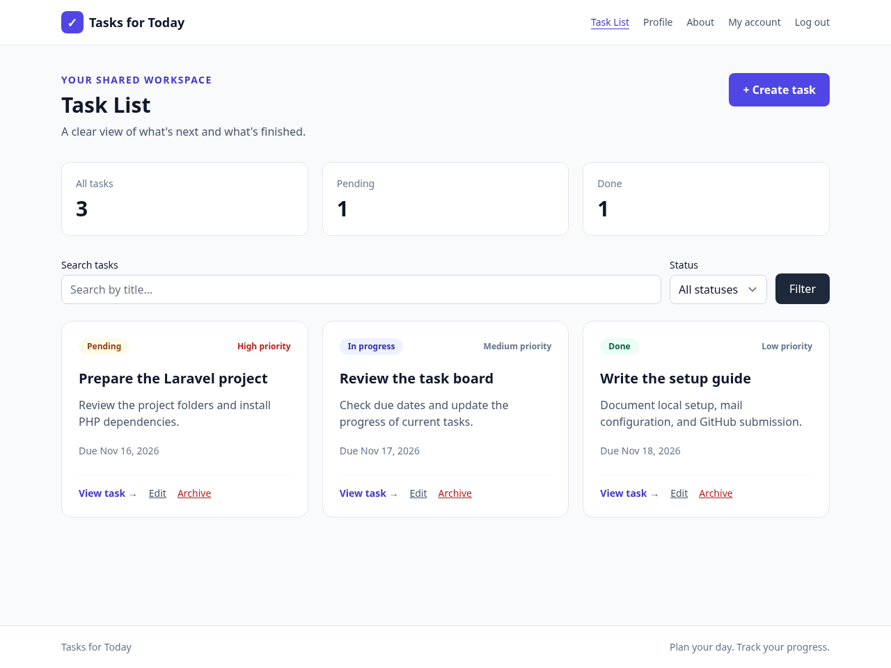

# Verification results

The delivered application was checked on PHP 8.4 with dependencies resolved for PHP 8.2 compatibility, and Chromium. The included GitHub Actions workflow runs on PHP 8.2 and Node.js 22.

- `php artisan test`: **38 tests passed, 159 assertions**.
- `npm run build`: production assets built successfully.
- Resource route inspection: index/show are public; create/store/edit/update/destroy include `auth` middleware.
- Chromium checks: Welcome, Task List, Profile, and About return successfully without login; guest Create redirects to login.
- Chromium checks: login, task creation, editing, archiving, logout, registration, and personal account page work.
- Real log mailer check: Pending → Done generated exactly one completion email; an additional edit while already Done generated none.
- Archive check: the task disappears from the public list and its details return 404. Automated tests also verify that its row remains with `is_archived = true`.
- CSRF check: a browser POST without a token returned 419.
- Responsive check: the task list was inspected at 1280 and 390 pixels; no horizontal overflow was detected at the smaller viewport.

The local setup was also exercised from a clean extraction of the ZIP. No GitHub repository or hosted deployment was created by these checks. Screenshots show local sample data.

